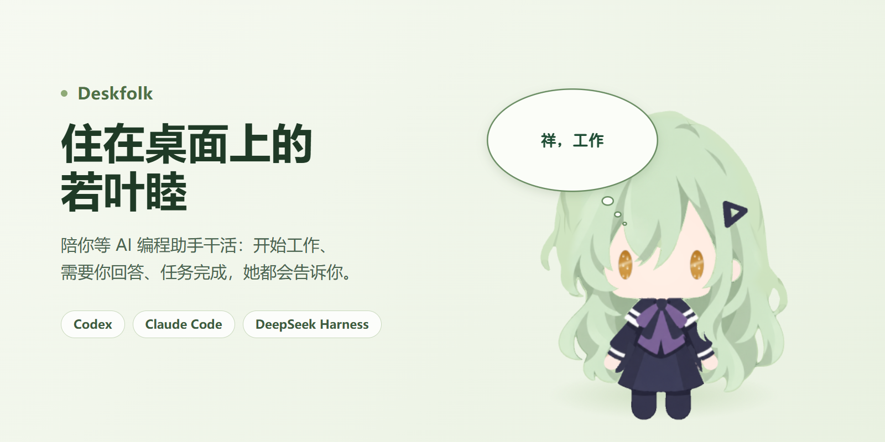
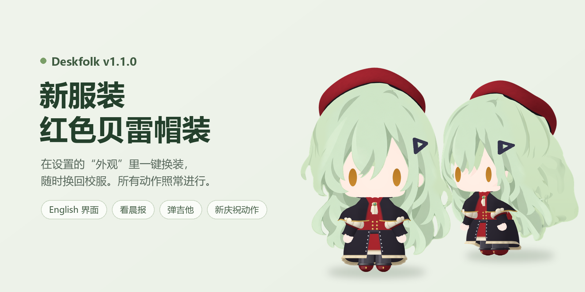

<p align="center"></p>

# Deskfolk

住在 Windows 桌面上的若叶睦。她会陪你等 AI 编程助手干活：开始工作、需要你回答、任务完成，她都会告诉你。

[下载 v1.1.1](https://github.com/DeriitoMe/Deskfolk/releases/tag/v1.1.1) · [发布说明](https://github.com/DeriitoMe/Deskfolk/releases/tag/v1.1.1) · [English](#english)

## 她能做什么

<p align="center"></p>


- **知道 Agent 在做什么**：开始工作、跑命令、改文件、等你回复、任务完成，都会变成她的动作和气泡。两个以上项目同时进行时，她会进入全力工作。
- **可以摸，也可以拖**：鼠标经过时她会看过来；点一下是摸头，连点十下会委屈；拖起来会晃，绕着她转三圈会头晕。
- **安静地陪着**：没事的时候会打盹、给黄瓜浇水、抱着吉他发呆；设置的“通知与陪伴”里可关闭彩蛋动作和音乐。任务完成时会跳起来拉响礼花筒。右键她会举起额度木牌，显示 Codex 或 Claude Code 的五小时剩余额度。
- **换装和语言**：设置里可以换上红色贝雷帽装，也可以把界面切换成 English。

<br clear="right">

<p align="center"></p>

## 支持的 Agent

| Agent | 接入方式 |
| --- | --- |
| Codex | 不用设置，Deskfolk 会自动读取本机 Codex 的工作记录 |
| Claude Code | 安装包已附带插件，需要 Node.js，运行一次下面的接入命令（[说明](plugins/deskfolk-claude-code/README.md)） |
| DeepSeek Harness | 安装包已附带插件，需要 Harness 0.2.1-rc.2 或更高版本（[说明](plugins/deskfolk-deepseek-harness/README.md)） |

接入 Claude Code：安装 Deskfolk 后在 PowerShell 运行下面的命令，然后重新打开 Claude Code。装在其他目录时把路径换成实际安装目录下的 `resources\plugins\deskfolk-claude-code\setup.mjs`；使用源码时在项目根目录运行 `node plugins/deskfolk-claude-code/setup.mjs`。

```powershell
node "$env:LOCALAPPDATA\Programs\Deskfolk\resources\plugins\deskfolk-claude-code\setup.mjs"
```

在设置的“跟随”里可以选择 **全部 / DeepSeek / Codex / Claude Code**，只看你关心的那一个。

## 下载安装

1. 在 [Releases](https://github.com/DeriitoMe/Deskfolk/releases/tag/v1.1.1) 下载 `Deskfolk-Setup-1.1.1.exe`。
2. 先退出正在运行的 Deskfolk，再运行安装程序。
3. 安装包没有数字签名，Windows 可能会弹出提示，可以先用同页的 `SHA256SUMS.txt` 核对文件。

更新安装时，原来的设置、通知记录和桌面位置都会保留。

## 怎么互动

| 操作 | 反应 |
| --- | --- |
| 移动鼠标 | 眼睛、头和身体跟着看 |
| 左键点击 | 摸头；连点十下会委屈 |
| 按住拖动 | 把她拎起来晃一晃 |
| 右键点击她 | 举起五小时额度木牌 |
| 右键托盘图标 | 设置、当前项目、看晨报、勿扰模式、退出 |

## 隐私

设置和通知记录只保存在本机。Agent 的状态通过只监听 `127.0.0.1` 的本机接口传给桌宠，不会发送你的提示词、代码、回答或密钥。

## 开发

需要 Windows 和 Node.js 24。

```powershell
npm ci
npm run dev        # 开发模式
npm run dist:win   # 生成安装包到 release/
```

架构、状态规则和验证方法见[维护交接文档](docs/AGENT_HANDOFF.md)。

## 说明

若叶睦是《BanG Dream!》系列的角色，角色版权归原作方所有。本项目是非官方的粉丝作品。

---

## English

Deskfolk is a small Windows desktop companion featuring a chibi Wakaba Mutsumi. She keeps you company while AI coding agents work, and lets you know when a task starts, when the agent needs your answer, and when the task is done.

- **Agent status at a glance**: working, running commands, editing files, waiting for you and celebrating completed tasks. She switches to full-power work when two or more projects run at once.
- **Supported agents**: Codex (automatic), Claude Code (plugin included in the installer; with Node.js installed, run `node "$env:LOCALAPPDATA\Programs\Deskfolk\resources\plugins\deskfolk-claude-code\setup.mjs"` once in PowerShell) and DeepSeek Harness 0.2.1-rc.2 or newer (plugin included in the installer). In settings, follow All, DeepSeek, Codex or Claude Code.
- **Interaction**: headpats, dragging, a dizzy reaction and a five-hour quota board on right-click. While idle she naps, waters her plants and daydreams with her guitar. Settings let you switch off easter egg actions and music.
- **Outfit and language**: switch to the crimson beret outfit and to an English interface in Settings.
- **Install**: download `Deskfolk-Setup-1.1.1.exe` from [Releases](https://github.com/DeriitoMe/Deskfolk/releases/tag/v1.1.1). The installer is unsigned; verify it with `SHA256SUMS.txt`.
- **Privacy**: everything stays on your computer. Agent status reaches the pet through a loopback-only local bridge, without prompts, code, answers or credentials.

Wakaba Mutsumi is a character from the BanG Dream! franchise; all character rights belong to their owners. This is an unofficial fan project.
