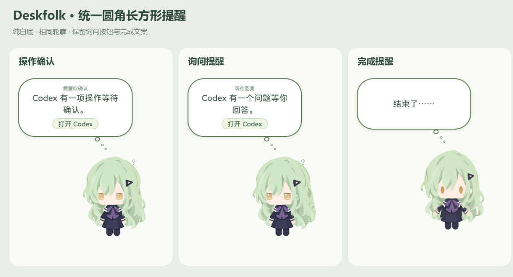
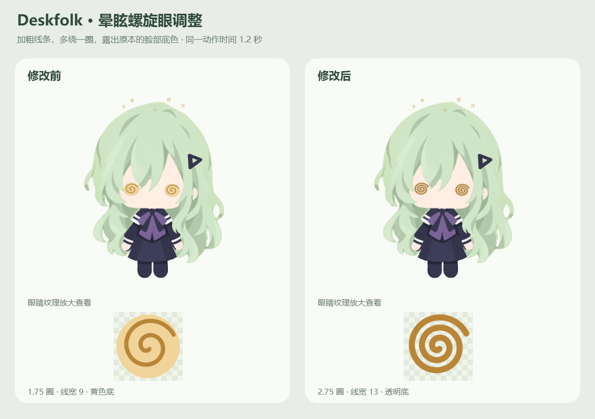

# 统一提醒气泡与透明底螺旋眼

日期：2026-10-06。应用版本保持 `0.1.0`。本机桌宠已更新并重启。

## 整理后的提示词

在现有 Deskfolk 项目中完成两项外观调整，先核对实际样式和眼睛绘制代码，保留修改前源代码与完整安装包。

1. 以“Codex 有一项操作等待确认”的圆角长方形提醒为视觉基准，将询问、成功完成、阶段完成、暂停、失败和额度耗尽等所有现有提醒统一成同一轮廓。短文案也要保留足够高度，避免变成扁椭圆。沿用纯白底、绿色轮廓、圆体字、提醒位置和现有按钮；保留文案、触发、显示时长与状态恢复逻辑。
2. 修改晕眩螺旋眼：加粗深色线条，在当前 1.75 圈基础上增加一整圈，移除黄色圆底，让线圈之间露出原来的脸部。保持与现有眼睛协调的颜色和大小，检查纹理透明、曲线清晰、模型部件尺寸与动作结束恢复。提供真实渲染预览。

## 核对结果

询问与权限提醒在代码中本来共用 `data-kind="question"` 样式，其高度差主要来自标题、正文换行和按钮。完成提醒则继承旧的百分比椭圆圆角，并且最小高度为零，一句“结束了……”只撑起约 60 像素，所以显得很扁。

仅修改圆角半径仍可能把短消息变成胶囊。此次统一轮廓、内边距和最小高度，短消息居中，长消息随内容自然增高。

## 一、气泡调整

文件：`renderer/style.css`。

- 所有提醒统一采用权限提醒的 **278 像素最大宽度、40 像素圆角、17／24 像素内边距**。
- 设置 **125 像素最小高度**，短完成消息也呈圆角长方形，文字垂直居中。
- 保留纯白底、绿色边框、圆润字体、现有小圆尾巴及阴影。
- 移除仅询问气泡使用的轮廓覆盖，所有类别共用一份样式。
- 尺寸乘既有 `ui-scale`，维持物理像素观感；最大宽度仍受安全可见范围约束。
- 原生询问／授权按钮继续显示“打开 Codex”；完成等提醒没有该按钮，完成标题仍隐藏，没有关闭叉号。

## 二、螺旋眼调整

文件：`renderer/three-rig.ts`，仅修改 `drawEye` 的晕眩绘制段。

| 参数 | 修改前 | 修改后 |
| --- | ---: | ---: |
| 圈数 | 1.75 | 2.75 |
| 线宽 | 9 | 13 |
| 径向增量 | 54 | 60 |
| 曲线采样段数 | 160 | 224 |
| 黄色圆形填充 | 有 | 无，线圈间透明 |

上述尺寸为纹理坐标单位。线条加粗约 **44.4%**；径向范围略增，使额外一圈和更粗线条仍保持清晰。线色沿用 `#b98537`，旋转速度不变。纹理始终先清空，完整晕眩时只绘制螺旋线，露出原有脸部。

鼠标四圈触发、晕眩时长、晃头、星光、打断和恢复流程保持原有实现。

## 三、验证

- `npm run build`、`git diff --check` 通过。
- 独立隐藏 Electron 实际窗口，通过生产通知接口验证七类气泡：授权、询问、完成、阶段完成、暂停、失败、额度耗尽。源码构建和打包 ASAR 均通过。
- 检查实际 DPI 下的圆角、最小高度、安全宽度、文字边界、纯白底、按钮和隐藏完成标题。询问仍在约 8 秒后退出；测试从截图完成时开始计时约 7.69／7.71 秒，前面约 0.3 秒用于等待入场与截图。
- 晕眩真实渲染预览约 **58.38 FPS**。两眼黄色填充像素均为零，线圈间存在透明像素；部件控制器尺寸与基线一致，约 4.001 秒恢复待机，结束回调恰好一次。
- 仅更新安装包的 `out/renderer`；主进程、Preload、图标及其他包文件的字节保持一致。
- 本机安装版已更新并重启，窗口响应正常。此次没有调整消息事件、授权流程或任务状态判断。

验证方法：私有测试配置、虚拟项目和通知载荷，未向真实会话写入测试事件。预览图来自实际桌宠渲染器，而非重新绘制的角色。

## 四、回退

私有回退根目录：`.cache/bubble-and-dizzy-20261006/before/`。

- `renderer/style.css`、`renderer/three-rig.ts`：本轮修改前的真实源码，包含此前已完成的功能。
- `installed/app.asar`：完整旧资源包。退出 Deskfolk 后恢复到本机安装目录的 `resources/app.asar` 并重新启动即可回退。
- 本轮预览、七类气泡检查、打包和部署报告均在 `.cache/bubble-and-dizzy-20261006/`，不进入 Git。

修改前安装包 SHA-256：`f12983cc251fe65ff9f422df599312c23bbef0b0add200545b079a25f048d917`。

修改后安装包 SHA-256：`f7d45bdc9e8b688d06fd8ca528c11b31c24527c363118cb3788bbecc76cfbd84`。
