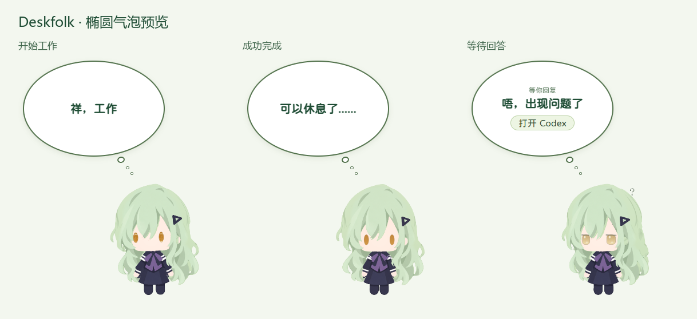

# 椭圆气泡 — 2026-10-13

按用户提供的椭圆参考图修改当前桌宠气泡。

- 基准外框：248×168 px，长宽比约 1.48。
- `border-radius:50%`，整体椭圆面积约 32,724 px²；原 278×125、40px 圆角气泡面积约 33,377 px²，缩小约 2%。
- 上下内边距 32px、左右 30px，均沿用现有 UI 缩放。高度为最小高度，长文案可自然增高。
- 保留白底、绿色描边、深绿加粗的圆润正文、三个音效和思考小圆点。
- 布局测量采用未受入场缩放影响的 `offsetHeight`，为更高的椭圆预留完整顶部空间。

## 验证

构建和封装通过。使用隔离的实际 Electron 主程序、预载与生产 3D 渲染器截图，三种文案的气泡实测均为 248×168、50% 圆角，窗口为 370×434，无遮挡或裁切。

逐个正文字符的 Range，以及可见问题标题和按钮的边界，均位于内椭圆中。问题标题最大椭圆归一化边界值约 0.787，按钮约 0.428，均小于 1。

主程序、预载、模型、美术、字体、音效保持原始字节，保留 24 个既有资源文件。原生事件接入和行为不变。

已安装并重启本机桌宠，本地接口与主窗口响应正常。最终档案 SHA256：`1b9369dcd1a7e825b36f7f9688a58b06645d516be0e26c758d22ec6527a44f31`。

## 文件与回退

- 修改：`renderer/style.css`、`renderer/main.ts` 中的气泡高度测量。
- 预览：`docs/images/bubble-ellipse-20261013.png`。
- 备份和验证：`.cache/bubble-ellipse-20261013/`。
- 上一版安装档案 SHA256：`56aa334854f9a807fff50b0f104d6daa478885208d4b44a1d6341d3f59d42757`。

可通过任务目录的 `deploy-live.py --rollback` 使用相同隐藏桌面启动方式恢复原安装档案并重启。源代码回退副本在 `before/renderer/`。本机配置与详细验证仍仅保存在被忽略的 `.cache` 内。

本轮没有上传或发布至 GitHub。
