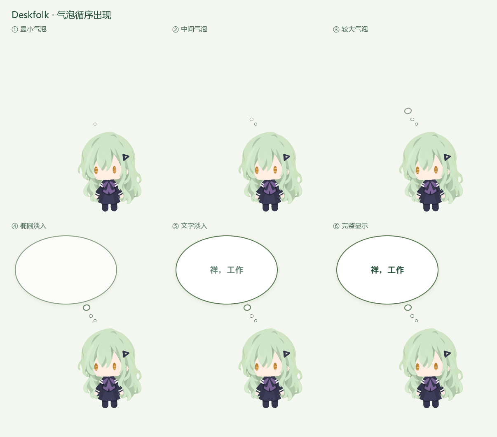
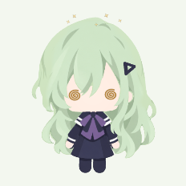

# 气泡循序出现与三圈绕晕 — 2026-10-13

## 气泡

- 三个小气泡增大，保持从大到小的排列。
- 出现顺序：最小圆点、中间圆点、较大圆点、椭圆主体、文字。
- 三个圆点分别从 0、0.13、0.27 秒开始淡入，主体从 0.42 秒淡入，文字从 0.68 秒开始淡入，约 0.9 秒完整显示。
- 主体背景绘制为独立层，圆点使用独立伪元素；透明度变化不会互相遮断。布局在入场前就预留完整尺寸，扩大后的圆点与头部有足够间隔。
- 音效随文字出现开始播放，关闭气泡或新通知替换时取消待播放音效并停音。保留原文案、白底椭圆、深绿粗体和原始三段声音。
- 桌宠设置或系统启用减少动画时，完整气泡立即显示。

## 绕圈

- 改为纯待机时，连续同方向绕满三圈触发晕眩。
- 修复轻微反向手抖导致整个累计进度清零，改为累计约 10° 才认定明确反向；反向距离仍从进度扣除，抖动不能凭空造圈。
- 有效半径为画布宽度的 0.22–1.65，允许正常的紧凑绕头圈。
- 修复慢速小角度移动丢进度；区分真实移动时间与静止补报，保持明显停顿、离开范围、工作等其他动作时重置。
- 保留跳变排除、6 秒冷却、4 秒晕眩自然恢复。宠物视线和绕圈中心不变。

## 验证

- 构建和 14 项绕圈相关测试通过。
- 使用隔离的实际 Electron 主程序、预载与当前 3D 渲染器，用私有原生事件记录驱动气泡。六个阶段的实际 CSS 透明度按顺序验证，语音启动约 684ms，通知替换时旧语音定时器成功取消。预览画面仅为确定帧而暂停/定位 CSS 动画，正常运行的声音延迟另行实测；QA 静音以避免测试出声。
- 绕圈验证覆盖真实 `screen.getCursorScreenPoint → 16ms IPC → renderer` 输入路径，未直接调用手势类或强制晕眩动作。画布 222.36DIP，整数坐标、50DIP 半径的小圈：两圈保持待机，第三圈包含约 1.83° 短反向抖动仍正常触发，约 4008ms 后回到待机。
- 模型、美术、字体、声音原始字节保留，原生工作状态接入、主程序、预载不变。
- 本机已安装并重启，窗口与本地接口响应正常。最终安装档案 SHA256：`ca35b0337dc1b75e68a13a70d2289c9ca1477c0e899ff4cbe5a074d43468aa33`。

## 文件和回退

修改：`renderer/main.ts`、`renderer/style.css`、`shared/orbit-gesture.ts`、`shared/orbit-gesture.test.ts`。

回退源文件、上一版安装档案及详细验证在 `.cache/bubble-orbit-20261013/`；上一版安装档案 SHA256 为 `1b9369dcd1a7e825b36f7f9688a58b06645d516be0e26c758d22ec6527a44f31`。使用任务目录的 `deploy-live.py --rollback`，通过同一隐藏桌面启动方式恢复上一版安装并重启。源代码副本在 `before/renderer/` 和 `before/shared/`。

本轮仅更新本机，没有上传或发布至 GitHub。
