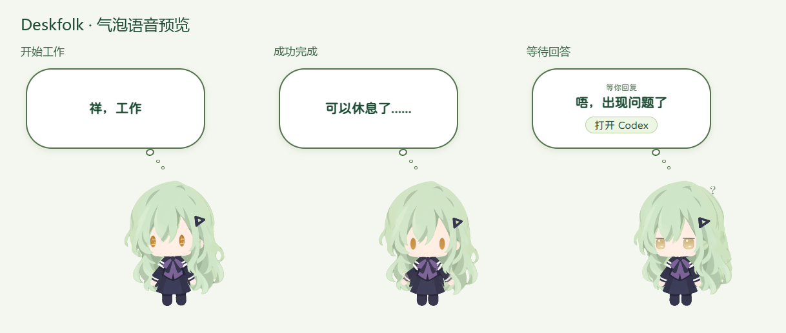

# 气泡音效与文字样式 — 2026-10-13

## 修改

| 气泡文案 | 原始音效 | 时长 |
|---|---|---|
| 可以休息了...... | `renderer/assets/audio/mutsumi-bubble-complete.wav` | 1.287 秒 |
| 祥，工作 | `renderer/assets/audio/mutsumi-bubble-working.wav` | 0.809 秒 |
| 唔，出现问题了 | `renderer/assets/audio/mutsumi-bubble-question.wav` | 1.386 秒 |

三段采用用户提供的独立 WAV，保留原始字节、音色和音量。均为 48 kHz、单声道、PCM24；峰值约 −11 dBFS，无削波。

- 气泡正文仍用 ChillRoundF 圆润字体，字号保持原来的 20.4px，字重调整为 700，深绿色为 `#1f4d35`。
- 正文单独启用 `font-synthesis: weight`，使静态常规字体能够实际显示加粗；页面其他文字的合成设置保持原样。
- 仅气泡显示且文案匹配时播放对应音效。单一 Audio 实例避免声音重叠，同一事件和文案最多播放一次；去重记录最多保留 256 条。
- 隐藏气泡时停音并复位；新气泡替换旧气泡时切换声音。通知关闭或勿扰时继续沿用原来的提醒规则。
- 新鲜、非子代理的原生工作开始事件显示“祥，工作”，以便该段声音真实可用。历史回放、Hook 工作通知和工具进度不会触发此开始提示。
- 保留现有庆祝、问题提醒期限、状态监视、托盘、拖拽、模型与眼睛。

## 验证

- 构建通过，原有提醒测试加工作开始过滤检查共 4 项通过。
- 隔离实际 Electron 主程序、预载及生产 3D 渲染器，用私有原生事件日志驱动提示，24 项检查通过。未发送测试事件至用户真实项目。
- 三段均触发真实 `playing` 和 `ended`，无播放拒绝或解码错误。QA 仅对其 Audio 设置静音，验证浏览器实际播放而不在测试期间出声。
- 重复开始与问题通知不重播；问题回答隐藏时停音；工作声音被问题声音替换时保持单一 Audio。
- 三种气泡均确认字重 700、合成粗体已启用、颜色 `rgb(31,77,53)`、字体加载成功且无裁字。
- 本机最终安装档案 SHA256：`56aa334854f9a807fff50b0f104d6daa478885208d4b44a1d6341d3f59d42757`。已重启，主窗口及本地接口正常响应。
- 安装包中原生主程序/预载字节保持不变，20 个原有美术、字体、历史样式文件保留，三段打包声音与原始字节一致。

预览：

## 回退

源文件、原构建、上一版安装档案以及本机配置回退副本保留于 `.cache/bubble-voice-20261013/before/`。上一版安装档案 SHA256 为 `fa48b053ad705330e20ab24b58385ef051f9fc47d5f05cab121d2790464f554a`。

使用任务目录下 `deploy-live.py --rollback` 的同一隐藏桌面启动方式可恢复上一版安装档案并重启。若回退源代码，同时恢复备份的 `renderer/main.ts`、`renderer/style.css`、`shared/reminders.ts` 与现有测试文件；新增声音可保留为素材。

本机私有配置和详细隔离验证在 `.cache` 中，不进入仓库或发布包。本轮没有上传或发布至 GitHub。
