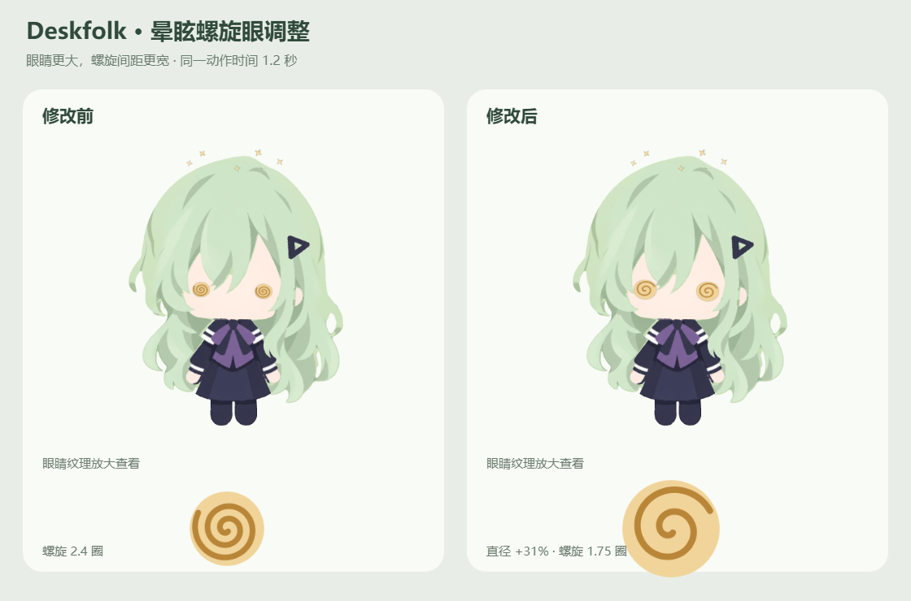

# 螺旋眼调整与其他 Agent 接入方案

日期：2026-10-06。第一项已实现；第二项仅调研和规划，没有实现接入代码。

## 整理后的提示词

在现有 Deskfolk 中完成两个任务：

1. 只修改晕眩表情的螺旋眼，使眼睛更大、螺旋线条间距更宽，并保持日常金色。保留鼠标四圈触发、动作时长、晃头、星光及恢复规则。先检查实际绘制代码，保留修改前源代码和安装包，提供同一时间点的对比预览并验证正常恢复。
2. 只读检查现有状态架构，查阅 DeepSeek Harness 官方资料，分析其他 Agent 的接入方式：是否需要独立桌宠版本、可复用哪些能力、需要哪些适配器和真实状态事件。区分已证实接口和架构建议，说明成功／停止／授权等事件的限制，不实现或安装 Agent 接入代码。

## 一、螺旋眼修改

修改：`renderer/three-rig.ts` 的晕眩眼睛绘制。

| 参数 | 调整前 | 调整后 |
| --- | ---: | ---: |
| 眼睛背景半径 | 52 | 68 |
| 螺旋圈数 | 2.4 | 1.75 |
| 螺旋径向增量 | 42 | 54 |
| 每圈径向间距 | 17.5 | 30.86 |
| 线宽 | 8 | 9 |
| 曲线采样段数 | 120 | 160 |

以上为眼睛纹理坐标单位，不是桌面物理像素。直径增大约 **30.8%**；每圈间距增大约 **76.3%**。线宽略增，保持缩小至桌面尺寸后的清晰度。



验证：构建和空白检查通过；隐藏真实 Electron 渲染器对同一动作的 1.2 秒截图进行对比。部件控制器尺寸未改变，4 秒末帧恢复，结束回调一次并回待机；采样约 **58.36 FPS**。此次仅替换安装包的渲染资源，其余包文件字节一致。已重启本机桌宠，版本仍为 `0.1.0`。

回退：`.cache/dizzy-eyes-20261006/before/three-rig.ts` 为修改前源代码；`before/installed/app.asar` 为完整安装包资源备份。退出桌宠后恢复该 ASAR 可回到调整前。验证与部署记录位于同一私有缓存目录。

## 二、是否需要给每个 Agent 单独发布桌宠版本？

**建议维护一个支持多 Agent 的 Deskfolk 安装包，为不同 Agent 提供各自的接入适配器。** 支持新 Agent 时正常升级 Deskfolk 即可，不需要长期维护“Codex 版”“DeepSeek 版”等多套桌宠产品。

这是基于现有架构的建议：模型、动作、托盘、设置和项目面板都可以共享；不同的主要是状态来源、事件语义、安装配置和打开宿主应用的方式。把差异放在适配器中，可避免修复同一动作时还要同步多套版本。

建议的结构：

```text
Codex 日志／Hook ──→ Codex 适配器 ────┐
DeepSeek Harness ─→ DSH 插件／适配器 ─┼→ 统一任务事件 → 项目聚合与动作选择 → 同一个 Deskfolk
其他 Agent ───────→ 对应适配器 ──────┘
```

用户下载一次 Deskfolk，再选择自己使用的 Agent。若宿主需要专用插件文件或配置，可另提供小型适配包；这是连接组件，不是一套不同的桌宠。

## 三、DeepSeek Harness 的可用接入方式

已核实真实官方项目为 [deepseek-ai/deepseek-harness](https://github.com/deepseek-ai/deepseek-harness)。它仍处于预览阶段，未来实现需要声明已验证的宿主版本。

| 方式 | 适合做什么 | 当前限制与建议 |
| --- | --- | --- |
| 原生 Cordis 插件 | 自动观察会话、Agent 状态、工具和子 Agent 事件 | 正式接入首选：将真实事件转换后发送给桌宠。 |
| MCP 通知工具 | 快速尝试完成或阶段消息 | 需要模型主动调用，不能保证所有开始、停止、取消及授权事件都送达。 |
| Codex Hook 兼容层 | 复用部分已有通知脚本 | 仅支持部分事件，不能直接复用完整权限提醒。 |
| Host 事件流 | 独立进程观察状态与历史 | 可作为另一条路线；当前 Gateway 使用 WebSocket 复用接口，不能把它写成固定 SSE API。 |

官方架构提供 Cordis 插件以及会话事件机制，适合制作观察型适配器。[架构文档](https://github.com/deepseek-ai/deepseek-harness/blob/master/docs/architecture.md)

官方 MCP 客户端支持外部 stdio 和 Streamable HTTP 服务；这是工具调用通道，不等于持续完整的任务生命周期监控。[MCP 客户端说明](https://github.com/deepseek-ai/deepseek-harness/blob/master/packages/mcp/mcp-client/README.md)

其 Codex Hook 桥目前支持 `SessionStart`、`UserPromptSubmit`、`PreToolUse`、`PostToolUse` 和 `Stop`；`PermissionRequest` 不在支持范围内。因此，不能仅复制现有 Hook 文件就宣称完整接入。[Hook 桥支持范围](https://github.com/deepseek-ai/deepseek-harness/blob/master/packages/hooks/hooks-codex/README.md)

Session Controller 提供历史、跟随与状态投影；当前 Gateway 的远程流使用 `/api/remote.mux` WebSocket。[Session Controller](https://github.com/deepseek-ai/deepseek-harness/blob/master/packages/api/session-controller/README.md)，[Gateway](https://github.com/deepseek-ai/deepseek-harness/blob/master/packages/api/gateway/README.md)

### 有希望更准确处理权限与终止

DeepSeek Harness 的原生权限类型包含按同一 ID 配对的 `approval/asked` 和 `approval/decided`，结果包含允许、拒绝、取消及不可用。适配器可观察这些事实来提示和解除等待，授权操作仍交给宿主界面。[权限事件源码](https://github.com/deepseek-ai/deepseek-harness/blob/master/packages/interaction/user-approval/src/types.ts)

会话事件也区分 `turn/end` 的正常结束、中止、阻塞、错误、输出上限及中断等原因。映射时必须保留语义：`max-tokens` 不能直接当作账户额度耗尽；单轮 `completed` 也不能自动当作用户整个项目完成。[会话事件与结束原因](https://github.com/deepseek-ai/deepseek-harness/blob/master/docs/subsystems/session.md)

## 四、Deskfolk 现有基础与下一步改造

已有可复用基础：本机带令牌的通知接口、事件词汇、会话去重、项目聚合、有限时长提醒、优先级恢复和实时动作渲染。

尚不能直接通用：当前事件来源含 `codex-log`，日志目录与侧栏项目读取器是 Codex 专用；默认会话 ID 读取 `CODEX_THREAD_ID`，询问说明及唤起入口也写着 Codex。现有 MCP 仅公开四类通知，不是完整的状态接入服务。

建议下轮按顺序实施：

1. **抽出通用协议和适配器接口。** 保留现有 Codex 适配器作为第一种来源，避免回归已修好的行为。
2. **增加来源隔离。** 每条事件包含 Agent、实例、会话、轮次、请求及项目身份；去重键加入来源与实例，避免两个 Agent 的相同 ID 冲突。
3. **定义跨 Agent 项目归属。** Agent 数量、会话数量与项目数量分开；同一项目的多个 Agent 不应因为来源不同就自动算成多个项目。目录／侧栏 ID 的跨来源对应关系应在实现前明确。
4. **制作 DSH 原生观察插件。** 接入真实开始、等待、授权决定、终止和子 Agent 信息；重启时读取有效当前状态，不按固定超时猜结束。
5. **显示能力差异。** 每个适配器明确支持哪些状态；缺少权限或停止事件时在面板说明，不伪造支持。
6. **提供宿主打开方式与安装向导。** 提醒按钮打开对应 Agent；安装步骤、插件信任、启动方式各自配置。Agent 的模型密钥继续由 Agent 自己管理，桌宠无需保存它们。
7. **做混合场景验收。** Codex 与 DSH 同时工作、同项目多来源、停止其中一个、两个权限请求分别解决、断线重连、桌宠和宿主重启。

本轮未新增适配器、未安装 DeepSeek Harness、未改动接入协议或其他 Agent 的配置。上述内容是下一阶段的实施方案。
