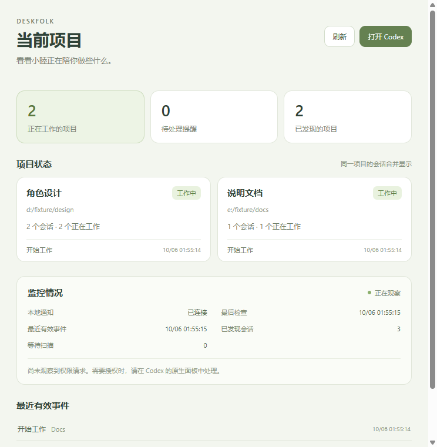
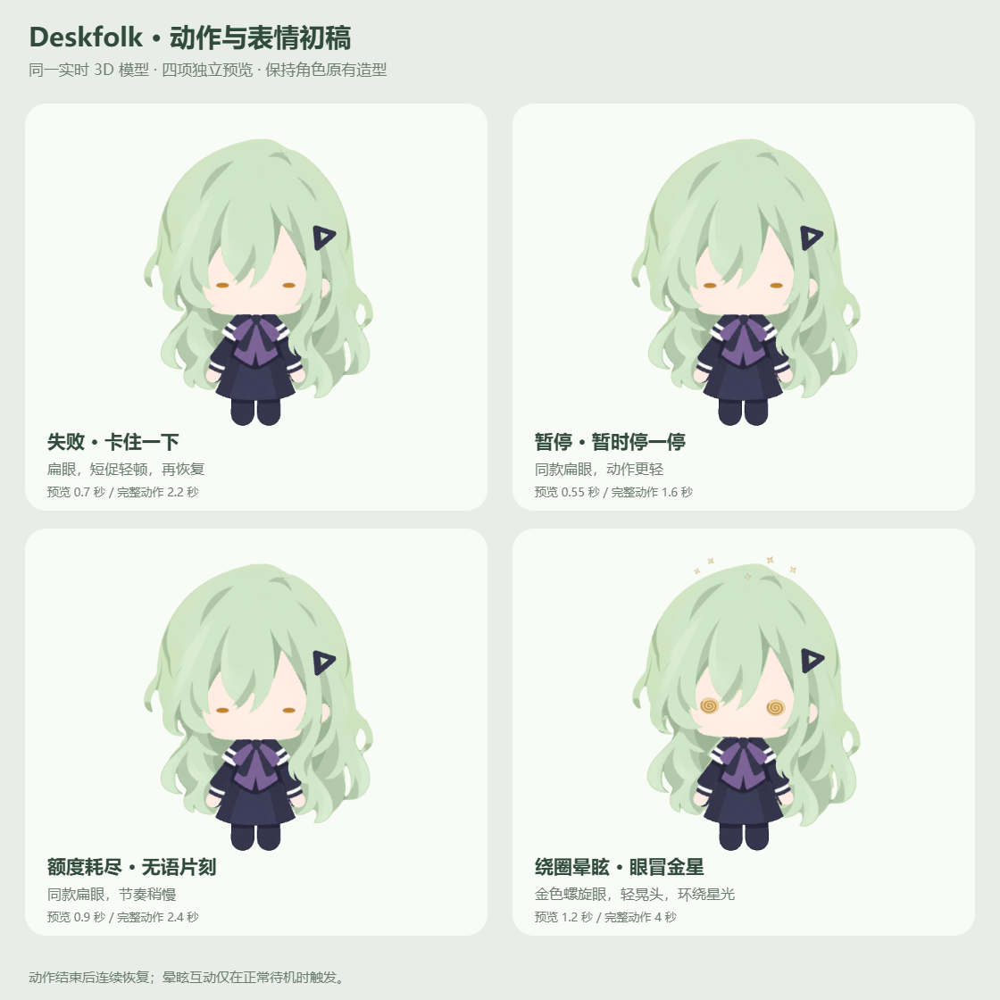

# Deskfolk 首批增强与晕眩互动初稿

日期：2026-10-06。应用版本保持 `0.1.0`。核对基线：`fb40c57`，修改前已包含本日 Zzz 放大；此次保留该调整。

## 整理后的实施提示词

在现有 Deskfolk 项目中，先核对运行方式、Codex 状态来源、现有动作、项目聚合及回退点，再实现首批四项增强：托盘“当前项目”面板；失败、暂停及额度耗尽反馈；临时动作优先级和恢复规则复核；勿扰及消息提醒开关。同时增加鼠标绕圈晕眩互动的初稿。

项目面板与状态规则应达到可使用和可验证的程度；表情动作先制作可调整的初稿。失败、暂停和额度耗尽共用日常眼色的扁眼与轻顿，通过文案和节奏区分。晕眩仅在纯待机中触发，鼠标连续同方向绕宠物四圈；反向、明显停顿或离开范围后重新计数。晕眩采用旋转螺旋眼、轻微晃头和环绕星光。

复用现有实时 3D 模型、Codex 日志／Hook、拖拽、托盘及庆祝逻辑。真实成功仍按既定 A／D 规则庆祝；失败、停止、暂停和额度耗尽不庆祝。所有临时动作结束后恢复当前真实状态；不按固定无事件超时猜测任务结束。权限由 Codex 官方面板处理；宠物只提醒。保存源代码、旧资源及验证记录。

## 一、已完成的四项

### 1. 托盘“当前项目”

- 系统托盘右键 → **当前项目**，打开独立面板；桌面常驻部分仍只有宠物。
- 显示工作项目数、待处理请求数、项目状态、会话数、最近有效事件和监控情况。
- 优先使用经校验的 Codex 本地侧栏项目 ID。同一项目多会话合并；不同侧栏项目即使共享目录，仍分开计数。没有侧栏信息时使用规范化绝对目录。
- 子代理不计为独立工作项目。没有可确认项目归属的会话显示“未归属项目”，不凭空计为新项目。
- 本地通知服务和日志观察器分别显示状态。“正在观察”来源于实际成功读取；安静时不会据此认定任务结束。
- 支持刷新、打开 Codex 和通知设置。打开 Codex 会唤起现有主窗口，保留它当前选择的会话，不宣称精确跳转到某条请求。
- 面板只展示必要项目元数据和事件标签，不复制工具参数、命令正文或聊天正文。

### 2. 失败、暂停、额度耗尽反馈初稿

| 反馈 | 表现与节奏 | 动作时长 | 气泡主文案 |
| --- | --- | --- | --- |
| 任务失败 | 金色扁眼，短促轻顿，平滑恢复 | 2.2 秒 | 卡住了……这次没能完成。 |
| 暂停／停止 | 同款扁眼，轻顿幅度较小 | 1.6 秒 | 暂停了…… |
| 额度耗尽 | 同款扁眼，节奏稍慢 | 2.4 秒 | 额度用完了……先休息一下。 |

仅确实支持的终局事件触发上述动作；普通工具错误文字不会被误当作任务失败。当前事件不能细分“暂停”与“手动停止”，共用暂停／停止反馈。

眼睛连续压缩到原高度约 18%，头、身体和四肢仍使用刚体控制器，不拉伸模型。结束后恢复仍在工作的其他项目、正常待机或其他实际有效状态。降低动态效果时减少晃动，保留有限时长与恢复。

### 3. 动作优先级与恢复

1. 用户拖拽／触摸优先于自动临时动作；新询问可打断触摸，拖拽期间继续保留移动能力。
2. 有效询问／权限提醒优先于失败反馈、庆祝和晕眩，视觉窗口固定 **8 秒**。
3. 终局反馈优先于成功庆祝；不同会话的反馈可排队，相同类型也会重新播放完整动作。
4. 每个已确认成功的会话轮次去重庆祝，保留启动随机 A／D、之后交替的规则。
5. 晕眩仅来自纯待机；工作、询问、点击或拖拽可打断，结束后重置待机计时。
6. 临时动作由真实动画结束回调及有限时长的视觉窗口恢复；这些期限只控制动画，不决定 Codex 任务是否结束。

修复：同项目非主导会话终止也能呈现反馈；旧轮次终止不能覆盖新轮次；重复和历史回放不重复播放；延迟读到的真实终止不会因事件时间较旧而漏播；低优先级气泡不会覆盖负反馈文案。

启动时只恢复仍真实待处理且未读的提醒。已处理请求、勿扰期间丢弃的提醒不会从旧历史重新弹出。多个请求按各自身份分别解除，一条回答或授权结果不能清空另一条待处理请求。

### 4. 勿扰与消息提醒

- **勿扰模式**：托盘及设置可切换，默认关闭。
- **消息提醒**：设置可切换，默认开启。
- 任一开关抑制提醒时，不弹气泡，也不自动播放询问、庆祝或终局反馈。真实任务状态、工作流光和超级工作仍持续同步。
- 手动触摸、拖拽和纯待机晕眩互动不受通知开关影响。
- 设置落盘；重新开启后不重播抑制期间的旧提醒。未处理的真实请求仍可在“当前项目”中查看。

## 二、晕眩互动初稿

- 仅正常待机有效，小憩、浇水、工作、超级工作及其他动作不计圈。
- 同方向连续 **4 圈**，支持顺时针及逆时针。
- 间隔超过 **900 毫秒**、明显反向、离开检测范围、瞬移或进入非待机状态，清空本轮计数。
- 检测环以显示画布中心为基准，半径约为画布宽度的 **0.28–1.5 倍**。
- 晕眩动作 **4 秒**，触发后 **6 秒**冷却，避免连续绕圈重复霸占动作。
- 沿用现有约 60 Hz 的全局鼠标采样及实时 3D 渲染，无新增外部输入服务。

## 三、真实权限提醒与接口限制

新增官方 `PermissionRequest` Hook。仅发送提醒，标准输出为空，不输出允许／拒绝决定，继续在 Codex 官方面板授权。通知截止约 1.4 秒，Hook 超时上限 2 秒；桌宠未启动也不阻断原有流程。

权限身份根据工具名称及实际工具输入的规范化散列计算，仅保存不透明身份，不转发命令正文、工具参数或响应。说明性顶层 `description` 不参与匹配，实际执行参数仍须一致。

- `PreToolUse` 不能解除权限等待，因为它发生在授权之前。
- 对应 `PostToolUse` 精确解除匹配请求；真实任务结束也会清理残余权限等待。
- 官方没有独立的“拒绝／取消授权完成”Hook。如果拒绝后没有匹配工具完成或任务终止事件，面板保守保留待确认记录；宠物的视觉提醒仍在 8 秒后退出。用户已确认采用这一规则。
- 同轮次、同工具、完全相同输入的并发请求会合并：官方 `PermissionRequest` 未保证独立工具调用 ID，不能宣称逐条区分。
- 本机插件源目录与 Codex 缓存中的 Hook 文件已更新并备份。**新增 Hook 仍需 Codex 重新加载及原生信任审核**，未改动信任策略、授权策略或自动批准配置。

依据：[官方 Hooks 文档](https://learn.chatgpt.com/docs/hooks)。已测试官方载荷对应的 Hook 脚本和实际桌宠接收链路；没有为验证而制造真实高风险授权请求，当前会话尚未完成新增 Hook 的原生信任审核。

## 四、修改文件

- `renderer/projects-view.ts`、`renderer/projects-view.css`：项目面板。
- `renderer/main.ts`、`renderer/index.html`：提醒队列、优先级、晕眩触发、通知设置和启动恢复。
- `renderer/three-rig.ts`、`renderer/v41-review.ts`：表情动作初稿与预览；保留本日 Zzz 字号调整。
- `shared/project-dashboard.ts`、`shared/orbit-gesture.ts`、`shared/outcome-feedback.ts`：统计、绕圈和终局反馈。
- `shared/activity.ts`、`shared/companion-feedback.ts`、`shared/reminders.ts`、`shared/types.ts`：请求独立生命周期、常量、队列及接口。
- `electron/main.ts`、`electron/preload.ts`、`electron/event-presentation.ts`：托盘、IPC、提醒展示及通知设置。
- `electron/codex-lifecycle.ts`、`electron/codex-projects.ts`：监控健康与侧栏项目名称。
- `plugins/liquid-glass-pet/hooks/hooks.json`、`notify.mjs`：权限提醒与精确解除。
- 对应单元测试，及 `scripts/qa-v42-priority-four.cjs`：实际运行回归。

初稿的可编辑来源是上述实时 3D 动作、眼睛绘制和效果参数；复用既有 Blender 模型及星光资源。此次没有改写模型、Krita 或 Aseprite 的唯一源稿。

## 五、验证

`npm run build`、`npx tsc --noEmit`、`git diff --check` 均通过。此次范围内 **99 项针对测试全部通过**。

真实 Electron 的私有测试配置通过原生日志、Hook 载荷、观察器、主进程、Preload 和生产渲染器验证；源码构建和待部署 ASAR **各 36 项检查通过**。测试使用独立虚拟项目，不向真实聊天写入演示事件。覆盖：双项目三会话统计、非主导会话暂停、失败／额度耗尽恢复、旧轮次和重复事件、勿扰持久化、两条问题分别解决、提醒 8 秒退出、授权匹配、通知关闭、工作期间绕圈无效、四圈晕眩、自然恢复、触摸／工作打断，以及托盘设置。

| 场景 | 源码构建 FPS | 打包 ASAR FPS | 打包 P95 帧间隔 |
| --- | ---: | ---: | ---: |
| 超级工作 | 59.49 | 59.68 | 18.0 ms |
| 普通工作 | 60.03 | 59.98 | 17.4 ms |
| 晕眩 | 59.99 | 59.99 | 17.3 ms |

方法：Windows、本机 Electron 37、隐藏真实窗口、关闭后台节流；从实际渲染帧采样，工作各约 2 秒，晕眩约 1.5 秒。该数据证明本机测试场景下的连续性，不代表所有机器的性能。

四项初稿独立预览约 60 FPS；所有部件控制器尺寸保持不变，末帧恢复正常，每个动作只触发一次结束回调。同类暂停反馈强制重播两次也通过。

本机安装版已替换资源包并重启，窗口响应正常。版本号保持 `0.1.0`；图标及其他包资源保持原字节。GitHub 未推送，Release 未变更。

## 六、回退

回退根目录：`.cache/priority-four-20261006/before/`，属于本机私有缓存，不进入 Git。

- `installed/app.asar`：此次部署前完整安装包资源，包含已放大的 Zzz。退出 Deskfolk 后替换当前安装目录的 `resources/app.asar` 并重新启动。
- 修改前的项目文件、`working.patch` 与 `head.txt`：恢复本轮修改时应使用此备份，避免直接重置 Git 而丢失先前 Zzz 修改。新增源码可先移入本机存档目录。
- `plugin-0`、`plugin-1`：两个本地插件目录修改前的 `hooks.json` 与 `notify.mjs`；按对应位置恢复并重新加载 Codex，再按其信任审核处理。
- 验证报告、打包校验、部署校验及预览参数在 `.cache/priority-four-20261006/`。其中私有测试配置不会进入仓库。

部署前 ASAR SHA-256：`8804e5dadcc3a1f43b52ff157c182c95e059e4eccf56c1b100a20d8d066fb3f0`。

部署后 ASAR SHA-256：`a88d8b8c5d0a90814e7faaae0ecaf2f4bee9729f14faeb98789ba72d4f0305c4`。
