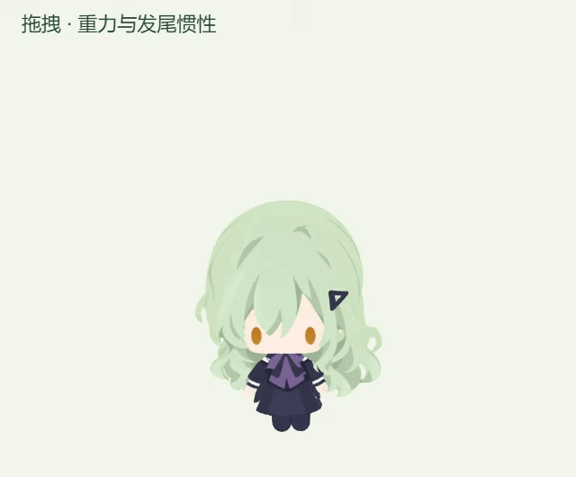

# 侧面发束阴影与拖拽惯性（2026-10-12）

## 原因与修改

浇水时头发总侧转约 18.9°，会露出侧面投影区域。原侧面贴图使用八条近乎纯色的宽阴影；部分接近朝前的弯曲表面也完整接收该投影，阴影会被挤成小块。

通过 Blender MCP 修改八条独立 Bezier 阴影的材质，加入柔和的宽度渐变和两处低对比反光，导出新的侧面贴图。在运行时保持原有静止模型空间的深度覆盖带，用静止法线的侧向程度，将阴影连续混合到同高度底色。颜色绘制随模型移动，正背面源图继续使用现有资源。

原拖拽弹簧/阻尼为 40/16，已属于过阻尼；不自然感还来自外力容易直接饱和、换向时方向符号突变，以及头发缺少独立惯性。现在采用弹簧 44、阻尼 22、速度滤波 120 ms、停止输入衰减 280 ms，外力与方向都平滑趋近目标。70° 上限沿用现有设置。

新增发尾惯性跟随：弹簧 64、阻尼 18，相对弯曲限制约 5.7°，仅影响模型空间高度 2.6 以下的下半头发；头皮与上部发束保持连接。发尾方向略滞后于整体摆动，释放时阻尼回正。减少动态效果模式下幅度为 35%。原 4.6 秒的放松—两次挣扎—放松循环和点击眼睛继续沿用。

## 可编辑资源

- `assets/characters/wakaba-mutsumi/side-hair-20261012/source/Side_Hair_Flow_20261012.blend`：独立发束阴影曲线、渐变节点与相机。
- 同目录 `Mutsumi_Side_Flow_20261012.blend`：侧面材质已更新的完整模型，图像均打包；头发网格坐标校验保持。
- 同目录 `refine-side-atlas.py`：可复查的 Blender 编辑脚本。
- `runtime/side-hair-flow.png`：2048×2048 新贴图；原侧面贴图和原 GLB 保留。
- `preview/`：正面、双侧与浇水实际运行渲染。
- 运行时代码：`renderer/three-rig.ts`、`shared/drag-physics.ts`、`shared/hair-physics.ts`。

本次 Blender 5.2.2 LTS 启动前未运行，现已恢复 MCP 连接。插件协议 11 的基础读写与截图可用。编辑脚本按插件安全模式使用直接节点和 Blender 保存/渲染操作。

## 验证

- TypeScript、构建及差异格式检查通过；发尾与点击动作的 7 项测试通过，拖拽物理 QA 通过。
- 同一短甩场景峰值由 29.99° 降至 21.65°；持续快速拖动峰值约 55.92°，长时间高速拖动可平滑接近 69.87°。30/60/120/240 FPS 数值测试峰值差约 0.32°。
- 发尾跟随在 30 FPS 相对 240 FPS 的最大差约 0.28°；停止、释放回正、重新抓取、抖动帧及无效输入均验证。
- 静态正面、浇水及两侧的透明轮廓逐像素相同。正面可见区域平均 RGB 差约 0.19/255，脸部和服装中心检查区域差为 0；仅发侧光影变化。
- 固定拖拽姿态比较发尾弯曲前后，画面上部像素保持，下半发束产生可见变化，所有控制器缩放保持 1。
- 同机 Windows x64 / Electron 37.10.3，60 FPS 设置，以相同隔离场景测量：

| 场景 | 修改前 FPS | 修改后 FPS |
| --- | ---: | ---: |
| 待机 | 60.01 | 60.00 |
| 浇水 | 60.00 | 60.00 |
| 拖拽 | 60.00 | 60.00 |

每个场景预热约 0.7 秒、采样约 2.2 秒。动态预览由实时渲染录制，GIF 为 24 FPS；性能数据来自独立的同条件采样，未降低运行帧率设置。

- 最终包通过原生鼠标输入检查：拖拽启动、持续移动、释放回待机、释放后点击均通过。前后物理测试与渲染录制使用隔离配置，不改动用户 Codex 会话。
- 打包核对原 15 份模型、美术与字体资源逐字节保留，新增侧面贴图；安装包版本维持 `0.1.0`。
- 本机安装与重启完成，实际用户配置下归档哈希和健康接口复核通过；当前未确认的工作记录为 0。

## 本机更新与回退

私有目录 `.cache/side-hair-drag-20261012/` 保存修改前源码、原安装包和实际用户状态备份。验证文件包括 `surface-comparison.json`、`drag-physics-verification.json`、`frame-rate-verification.json`、`drag-animation-verification.json`、`native-qa/verification.json`、`package-verification.json`、`deployment-verification.json`。

原包 SHA256 为 `92fae92e10606026c19b8272c4406b53554fa5124f28fea5b1685576543554b8`，本轮包为 `33a21aef5d3211a951403642f207a449a422c204841f31aa674983a471a5443b`。

独立隐藏助手运行 `deploy-live.py --rollback` 可校验当前哈希后恢复原安装包并重启，保留当前偏好。源码回退时恢复 `before/source/` 中的原绘制、物理与 QA 文件；新增资源和 `hair-physics.ts` 可留作编辑存档。仅更新本机，未上传 GitHub。
