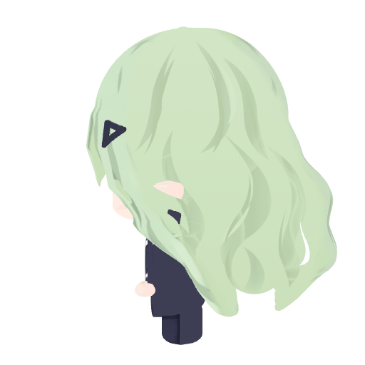
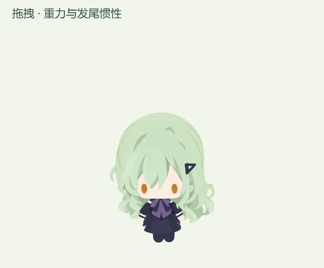

# 侧面发束线条与更大发尾摆幅（2026-10-12）

在上一轮实现上增加 8 条独立、收尖的鼠尾草绿阴影线，保留 8 条宽发束阴影及轻柔反光。阴影线以明确的窄色面分隔发束；侧面贴图采用最高 8 倍、受显卡能力限制的各向异性采样，改善斜侧视角的清晰度。

可编辑源稿位于 `assets/characters/wakaba-mutsumi/side-hair-lines-20261012/source/`：`Side_Hair_Lines_20261012.blend` 是分层阴影曲线与材质源稿；`Mutsumi_Side_Lines_20261012.blend` 是更新纹理并打包图像的完整模型。`runtime/side-hair-lines.png` 为 2048×2048 导出贴图，`refine-side-lines.py` 保存 Blender 编辑操作。原模型、上一轮源稿与贴图保留。

发尾相对弯曲上限从 0.10 增至 0.18 rad，约为 5.7°→10.3°；身体角度跟随系数为 0.36，角速度系数为 0.022。弹簧 64、阻尼 18、时间步设置继续沿用。身体重力曲线、70°倾角上限与挣扎周期保持现有实现。

## 验证与本机更新

- TypeScript、构建、5 项发尾物理检查及原生鼠标拖拽检查通过。
- 20°身体倾斜下稳定发尾摆幅约 4.4°→7.2°；相同动态预览轨迹的峰值约 5.64°→10.05°，增加约 78%。
- 30 FPS 相对 240 FPS 的最大轨迹差约 0.46°，按 100 像素发尾有效半径约 0.8 像素。停止与释放正常回正，发根像素检查稳定。
- 正面、浇水和两侧的透明轮廓完全一致；正面脸部检查区域差为 0。
- 相同隔离 Windows x64 / Electron 37.10.3 场景，60 FPS 设置，预热约 0.7 秒、采样约 2.2 秒；修改前后待机、浇水、拖拽均约 60 FPS。预览 GIF 为 24 FPS。
- 原安装包的 16 份模型、美术和字体逐字节保留。上一轮侧面贴图在包内留作存档，运行使用新贴图。

本轮私有目录：`.cache/side-hair-drag-lines-20261012/`。`before/source/` 保存绘制与发尾物理源码，`before/installed/app.asar` 保存上一包，`before/user-data/` 保存实际用户配置。验证记录包括 `surface-comparison.json`、`hair-amplitude-verification.json`、`frame-rate-verification.json`、`native-qa/verification.json`、`package-verification.json` 和 `deployment-verification.json`。

版本保持 `0.1.0`。原包 SHA256 为 `33a21aef5d3211a951403642f207a449a422c204841f31aa674983a471a5443b`，本轮包为 `e38a62b800fe55a3eec1a575e0e8d70161485d6e5ef47cc292aed0ff2d18eaee`。

独立隐藏助手运行本轮 `deploy-live.py --rollback`，可在核对当前包后恢复上一版并重启，保留当前偏好。源码回退时恢复本轮 `before/source/renderer/three-rig.ts` 和 `before/source/shared/` 下的两份发尾物理文件。仅更新本机，未上传 GitHub。
