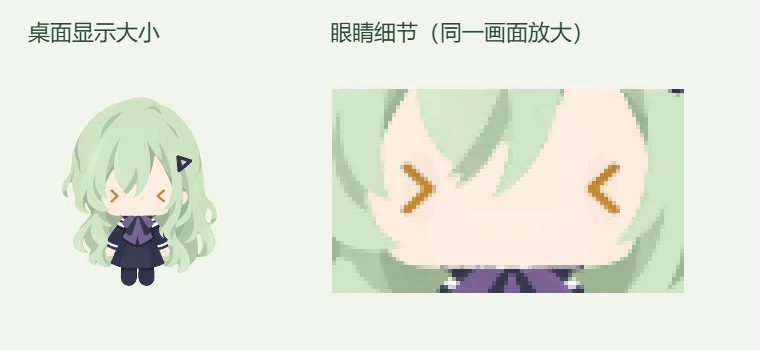

# 委屈泪眼与轻晃高光（2026-10-09）

## 视觉与源稿

沿用用户参考的米金色眼底、暗面和圆角眼型，用轻微内高外低的眼睑弧度表达委屈。上方竖椭圆、下方横椭圆高光随薄透明泪膜缓慢偏转、伸缩及轻颤；头部角度、收手姿态保持。

- 以原 `v41-3d/source/question-eye.kra` 的 `eye-gold`、`eye-lid`、`eye-highlights` 分层为基准，在副本中分离眼底与可动部分。
- 使用本机 Krita 导出 `assets/characters/wakaba-mutsumi/tearful-20261009/runtime/tearful-eye-base.png`。对应可编辑文件为同目录 `source/tearful-eye-base.kra`，原三层均保留。
- Canvas 绘制源稿在 `renderer/three-rig.ts`；反光相位在 `shared/tearful-motion.ts`。主高光透明度恒定，偏转与位置平滑变化，减少动态模式采用更轻、更慢的变化。
- 眼睑在泪眼期间保持稳定。内端较基础位置轻抬、外端略低，实际显示高差约 1 像素。头部和其他动作实现保持。

## 规则与验证

保持十次有效左键点按触发、超过 3 秒间隔重计、反应约 4 秒、持续点按不延长时长的规则；拖拽、取消和优先级反馈按原流程接管，随后恢复当前实际活动。

- 十项触摸、计数及泪膜曲线测试通过；TypeScript、构建与差异格式检查通过。
- 核对 `three-rig.ts` 内眼睛绘制和新增底图加载之外的代码与本轮前保持一致；原 Blender 模型与其他动画资源保留。
- 以约 195 像素高的角色检查原尺寸与放大连续帧。独立美术审阅确认清亮金色、轻微委屈情绪与自然的高光偏转；水光动感保持克制。
- 真实第十次原生鼠标点击连续录制约 5.82 秒，337 帧，平均 58.05 FPS。GIF 为 24 FPS 预览，运行时保持原 60 FPS 设置。
- 最终包通过 24 项隔离输入/恢复检查，反应约 4.028 秒。动态高光变化留在眼睛实际透明轮廓内，眼睑和上方暗边稳定；工作/问题恢复验证使用现有协议的 IPC 夹具，未改变真实会话。
- 原有 14 份运行时模型、美术和字体资源逐字节保留，新增眼睛底图约 6 KB。安装包版本保持 `0.1.0`。

## 本机更新与回退

本轮私有目录：`.cache/tearful-surface-20261009/`。

- `before/source/` 保存修改前绘制代码、曲线和测试；`before/installed/app.asar` 保存上一安装包。
- `art-proof/verification.json`、`live-preview/recording.json`、`qa-packaged/verification.json` 保存视觉、连续播放和交互验证。
- `package-verification.json`、`deployment-verification.json`、`installed-health.json` 保存安装校验。本机更新与重启后检查归档和健康接口；保留当前用户偏好和状态。
- 上一包 SHA256：`cfc27cd6b27468c829433121c9f9c3f81ca1d63c677e95b3d022debf6f981fba`。
- 本轮包 SHA256：`a47aa623cca964519d2f6fb70ea4cfa2a143ec42031d4e40422d3dfee08c24d6`。

执行目录内 `rollback.ps1` 可核对当前包后恢复上一版并重启；如果已安装后续包，会停止回退。源码回退时恢复 `before/source/` 中本轮三个文件。本轮未上传 GitHub。
