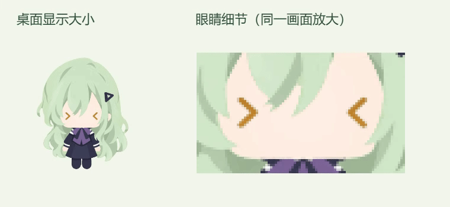

# 正向微低头与米金泪眼（2026-10-09）

## 参考与表现

本轮将用户两份参考结合：正面微低头采用动态演示的姿态，眼睛采用静态图中的圆角米金眼底、上方暗面、平直灰绿眼睑，以及上方竖椭圆、下方横椭圆高光。

正面双眼使用相同基础尺寸。两处高光随透明泪膜平滑移动、轻微偏转及伸缩；高光主体透明度保持稳定，整段反应的进入与退出沿用原有淡入淡出。头部控制、动作时长和十次点按触发规则保持现有实现。

## 文件与验证

- 本轮运行时代码：`renderer/three-rig.ts` 的 `drawTearfulEye`。
- 可编辑眼底与分层继续使用 `assets/characters/wakaba-mutsumi/tearful-20261009/source/tearful-eye-base.kra`；运行时底图与原始模型均保留。动态高光由 Canvas 绘制。
- TypeScript、构建、十项触摸/计数/水光测试通过。
- 真实 3D 渲染对照确认眼睛绘制之外的姿态代码与本轮备份一致，部件缩放保持 1。
- 固定头部姿态，在 222 像素画布比较两个水光时间点：两眼分别有 28、26 个像素产生超过 15 级的颜色变化，高光运动可在桌面尺寸辨认。
- 隔离生产渲染器通过原生鼠标点按录制，约 5.827 秒、339 帧，平均 58.11 FPS；交付 GIF 为 24 FPS。
- 最终包 24 项交互检查通过，包含触发、拖拽打断、恢复及减少动态效果；工作/提问恢复使用现有协议的隔离 IPC 夹具。两眼动态像素均保持在遮罩内，上眼睑与暗边稳定。
- 本机更新与重启完成，安装归档哈希和健康接口复核通过。

## 本机更新与回退

本轮备份、安装包与检查记录在 `.cache/tearful-front-20261009/`。安装版本保持 `0.1.0`，全部 15 份既有运行时模型、美术和字体资源逐字节保留。

- 上一安装包：`before/installed/app.asar`。
- 上一绘制源码：`before/source/renderer/three-rig.ts`。
- 制包记录：`package-verification.json`。
- 连续录制与交互记录：`live-preview/recording.json`、`qa-packaged/verification.json`。
- 更新后校验：`deployment-verification.json`、`installed-health.json`。
- 本轮包 SHA256：`39fcfe72da90af4fff8620daaca29fa1058e225c8a636614ea23204e04227025`。

执行本轮目录内的 `rollback.ps1` 可恢复上一安装包并重启，保留当前用户偏好。脚本会核对版本文件哈希，若后续版本已安装则停止回退。源码回退只需恢复本轮备份的 `renderer/three-rig.ts`。本轮仅更新本机。
