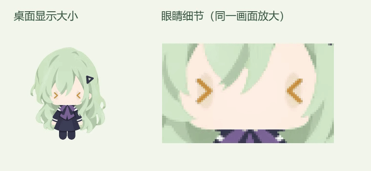

# 参考眼型与泪面波光（2026-10-09）

此文保留参考眼型接入记录。同日委屈泪眼进一步完善，现行效果、源稿与回退入口见 [委屈泪眼与轻晃高光](touch-tearful-eyes-20261009.md)。

## 修改

将十次点按委屈反应的基础眼睛改为用户所给参考图的样式，并叠加持续游动的泪面反射。

- 参考图：`codex-clipboard-aaa22d7e-16dd-40dd-9188-12f0dd802fe1.png`，另存于本轮私有目录的 `reference/eyes.png`。
- 使用现有 `assets/characters/wakaba-mutsumi/v41-3d/runtime/question-eye.png` 底图，保留米金渐层、顶部暗面、暗边、水平眼睑、左上竖高光及右下横高光。可编辑美术源稿 `v41-3d/source/question-eye.kra` 保持。
- 左眼略小、右眼略大，尺寸在眼图稿中适配。薄透明泪面与两段弯曲反射叠在下半眼，反射持续移动；减淡水润覆盖层以保留底图色彩与固定高光。
- 本轮源码仅修改 `renderer/three-rig.ts` 中的 `drawTearfulEye`。其余绘制、头部角度、动作姿态和点击计数代码逐字保持，`shared/tearful-motion.ts` 曲线不变。

## 验证

- 七项计数与反光测试、TypeScript、构建与差异格式检查通过。
- 固定姿态抽查 91 个反光相位：两眼持续有明亮反光，位置和曲率变化可辨；独立视觉审阅确认基础眼型、固定高光与暗面匹配参考。
- 原生十次点击连续录制约 59.18 FPS。动态反射偶尔经过右下固定高光后自然合并、分离；左上固定高光稳定保留。
- 最终包通过 24 项隔离交互检查，反应约 4.136 秒；动态变化均位于参考眼睛的实际透明轮廓内。顶部高光与暗面没有可见变化，仅少量抗锯齿边缘存在 1/255 色值舍入差。测试按实际透明轮廓验证，适配参考右眼宽度。
- 工作、停止和问题优先级恢复使用现有协议 IPC 夹具，未改变真实会话。原有 14 份模型、美术与字体资源逐字节保留。
- 本机已更新、重启，归档与健康接口验证通过；版本仍为 `0.1.0`，未上传 GitHub。

## 回退

私有记录目录：`.cache/tearful-reference-20261009/`。

- `before/source/renderer/three-rig.ts` 保存上一绘制版本；`before/installed/app.asar` 保存上一安装包。
- `art-proof/verification.json`、`live-preview/recording.json`、`qa-packaged/verification.json` 保存视觉、连续播放和交互检查。
- `package-verification.json`、`deployment-verification.json`、`installed-health.json` 保存安装验证。
- 上一包 SHA256：`24c0632710db2e99ca8f47764320e3bb7c6958277e21e7f3cec95b4fb38e4534`。
- 本次包 SHA256：`cfc27cd6b27468c829433121c9f9c3f81ca1d63c677e95b3d022debf6f981fba`。

执行目录内 `rollback.ps1` 可核对当前包并恢复上一版，保留当前用户状态；如已经安装后续包，会停止回退。源码回退仅恢复该目录的原 `three-rig.ts`。
