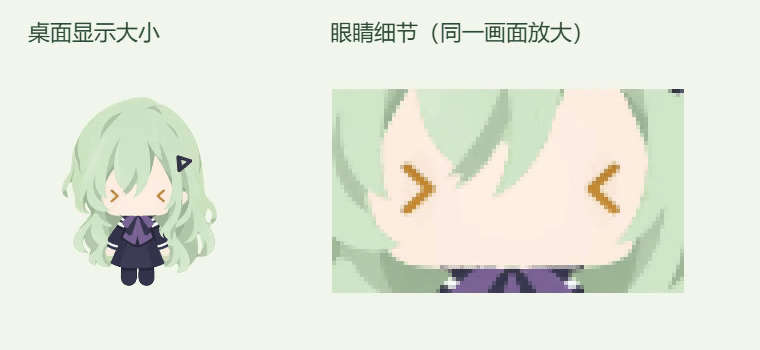

# 泪眼视觉修订（2026-10-09）

此文保留第一轮视觉修订记录。同日眼内反光已按用户反馈改为持续游动的水面波纹，现行效果与回退入口见 [泪面波纹微调](touch-tearful-ripples-20261009.md)。

## 执行要求

排查十次点按后泪光难以观察的原因，重做清楚闪动的眼内泪面反射。为委屈反应设计独立姿态，与疑惑偏头区分；保持角色造型、点按规则及其他动作。检查真实桌面尺寸下的连续播放，更新本机并提供动态预览。

## 原因与修改

- 旧效果有动态时钟，但眼睛显示较小，水线、反光位置变化不足一个屏幕像素；低透明度下难以辨认。
- 旧姿态的身体转向、头部偏转与疑惑动作接近，泪眼又复用了疑惑图稿，因此整体辨识度不足。
- `renderer/three-rig.ts` 现在独立绘制琥珀色泪眼、内侧抬起的眉形和下部水润层；左右分段弧线表现泪面，斜反射随时间亮起、淡去及轻微移动。
- 姿态改为正面轻低头、身体略下沉、双手收近身体。起始轻颤迅速衰减，随后保持轻微呼吸；控制器缩放始终为 1。
- `shared/tearful-motion.ts` 集中定义反光与反应强度曲线。常规泪光周期约 0.88 秒，减少动态模式约 1.4 秒，并关闭反光位移与头部轻颤。泪光使用独立的实际经过时间，不因继续按头重置。
- 反应开始约 0.18 秒淡入，最后约 0.45 秒恢复；重复按头时保留委屈姿态，最大头部按压位移维持原值。

## 互动规则

保留已有规则：十次有效左键点按触发，相邻点按超过 3 秒重新计数；反应持续约 4 秒。期间继续点按不累计、不延长反应。拖拽、取消与模型重建清理互动；真实问题和已有高优先级反馈正常接管，结束时恢复当时实际的工作或待机状态。

## 验证

- 十项按压、计数和反光曲线测试通过；TypeScript、构建及差异格式检查通过。
- 源码与最终安装包分别通过 24 项隔离交互检查：原生 Electron 鼠标输入、十次阈值、重复点按、间隔重计、右键、拖拽、指针取消及恢复路径。反应寿命分别为 4.086 秒、4.090 秒。
- 工作、停止和问题优先级的恢复检查使用符合现有协议的 IPC 夹具，未修改真实 Codex 会话。
- 默认缩放下角色约 195 像素高。固定姿态对比泪光峰谷，两眼分别有 52、50 个像素的通道差超过 25，最大差为 174、161。动态反射变化保持在眼睛范围内；眼外变化为零。
- 真实第十次点击连续录制约 5.82 秒，343 帧，平均 59.08 FPS；包含按头、泪眼闪动及恢复。录制采用隔离的离屏窗口，同一运行时渲染器、输入与动作逻辑，桌面显示尺寸与像素放大对照同时保留。
- 人工检查桌面原尺寸峰谷与连续帧；独立审阅确认泪光清楚起落，低头收手能表达委屈，与疑惑偏头区分，未见头身和手臂连接跳裂。预览 GIF 为 20 FPS，运行时仍按原 60 FPS 设置。
- 包内原有 14 份模型、美术与字体资源逐字节保留，非 `out` 文件保持；本机归档校验、进程重启和健康接口检查通过。版本保留 `0.1.0`，未上传 GitHub。

## 源稿与记录

本轮代码修改为 `renderer/three-rig.ts`，新增 `shared/tearful-motion.ts` 及测试。眼睛可编辑源稿为 Canvas 绘制代码，不改 Blender 模型与已有角色图稿。

私有验证目录：`.cache/tearful-refine-20261009/`。

- `art-proof/verification.json`：姿态和桌面尺寸泪光差异。
- `live-preview/recording.json`：连续播放帧率及反应过程。
- `qa-source/verification.json`、`qa-packaged/verification.json`：交互检查。
- `package-verification.json`、`deployment-verification.json`、`installed-health.json`：打包、安装与健康检查。
- 测试窗口首次加载时需要等原生布局及鼠标命中 IPC 就绪；该等待仅在私有测试脚本中，未修改产品输入逻辑。

## 回退

本轮更新前包保存在 `.cache/tearful-refine-20261009/before/installed/app.asar`，原 `three-rig.ts` 保存在 `before/source/renderer/`。用户状态另作私有备份，未清空偏好或记录。

- 更新前 SHA256：`8c317e4578612ac74bdde1ab09912c8ee5011ba6f50b3ad34be57ac4fce0d3ca`。
- 当前包 SHA256：`a6cecee6cc928bb242c87a07c7210c60a84a57d86b6b99402dc79bcc6d0ba898`。

运行该目录的 `rollback.ps1` 可核对当前包后恢复上一版并重启，保留当前用户状态；如已安装后续新包则停止回退。源码回退仅需恢复备份的 `three-rig.ts` 并移除本轮新增的两个 `tearful-motion` 文件，其他既有改动保持。
