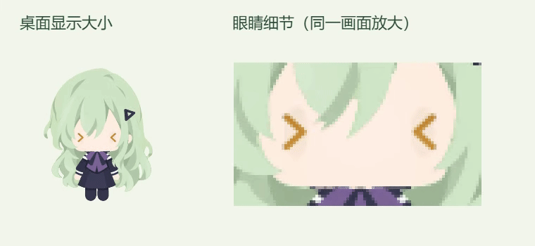

# 泪面波纹微调（2026-10-09）

此文保留波纹运动修订记录。同日按用户新参考更新了基础眼型、固定高光和暗面，现行效果见 [参考眼型与泪面波光](touch-tearful-reference-20261009.md)。

## 效果与范围

高光持续存在，在眼睛下部的水润泪面上游动，呈现弯曲水纹的反射感。保留此前认可的头部角度、眉形、身体姿态和十次点按规则。

- `shared/tearful-motion.ts`：反光主透明度固定为 0.94；通过位置、方向和曲率变化表现流动。主轨迹约 2.25 秒一周，横向幅度 23、纵向幅度 11（眼图稿坐标）；减少动态模式使用更缓慢、较小幅度的移动。
- `renderer/three-rig.ts`：两段渐细弯曲反光在泪面不同位置连续游动，辅反光采用反向运动；水润层与柔光持续保留。自然进入与退出仍按原反应强度混合。
- 更新对应反光测试。可编辑眼睛源稿仍为 Canvas 绘制代码。

## 验证与本机安装

- 十项按压、计数、反光曲线测试通过；TypeScript、构建与差异格式检查通过。
- 去除 `drawTearfulEye` 绘制段后，`three-rig.ts` 与修改前逐字相同；头部姿态与其他动作代码保持。
- 固定姿态连续抽查 91 个反光相位：两眼均持续保有明亮反光，原眼图稿中明亮像素数分别为 820–1084、831–1079；反光重心横移约 25 像素、纵移约 20 像素，默认桌面尺寸可辨认位置变化。
- 检查约 195 像素高的角色及连续原生十次点击画面；独立视觉审阅确认弯弧持续可见，并在泪面移动、转向及改变曲率。
- 连续录制平均约 58.84 FPS；预览 GIF 为 24 FPS。最终安装包通过 24 项隔离交互检查，反应约 4.047 秒，动态反光保持在眼睛范围内。工作/问题恢复路径使用现有协议 IPC 夹具，未改变真实会话。
- 原有 14 份运行时模型、美术和字体资源逐字节保留；本机更新、重启、归档和健康接口检查通过。版本仍为 0.1.0，未上传 GitHub。

## 回退与记录

私有工作目录：`.cache/tearful-ripples-20261009/`。

- `before/source/` 保存本次修改前的绘制代码、反光曲线及测试；`before/installed/app.asar` 保存上一安装包。
- `art-proof/verification.json` 保存持续反光、位置变化及姿态不变检查；`live-preview/recording.json` 保存真实点击连续录制信息；`qa-packaged/verification.json` 保存交互检查。
- `package-verification.json`、`deployment-verification.json`、`installed-health.json` 保存安装结果。
- 更新前 SHA256：`a6cecee6cc928bb242c87a07c7210c60a84a57d86b6b99402dc79bcc6d0ba898`。
- 本次包 SHA256：`24c0632710db2e99ca8f47764320e3bb7c6958277e21e7f3cec95b4fb38e4534`。

执行该目录的 `rollback.ps1` 可核对当前包后恢复上一版并重启，保留当前用户偏好和状态；若安装了后续新包，会停止回退。源码回退时，仅恢复 `before/source/` 中本轮三个文件。
